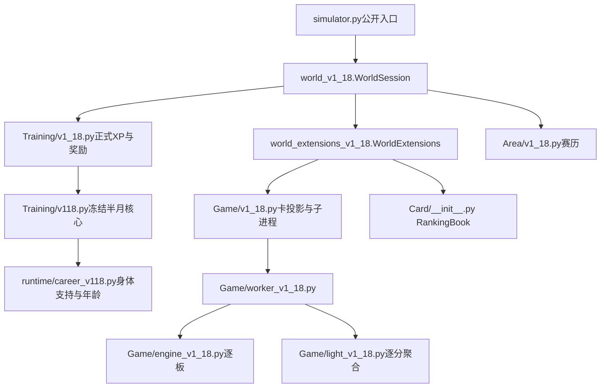

# 实际源码入口图｜可读的V1.18基线

不是新上传2004—2006包的认证地图。源码根为前轮发布spin_era_v1_18。

- 世界比赛输入：world_v1_18.py:307的_match_card；身体支持由Training.performance_card给出。
- 外部结算：world_extensions_v1_18.py:194的settle_match；内部总账事务在:132的_settle_inplace。实际起始行以源码rg为准，补丁后可能移动。
- 旧签表整场运行：world_v1_18.py:532的run_event；不是逐轮待授权会话。
- 小组：world_extensions_v1_18.py:289的run_group；积分与H2H经统一事务，原版组末伤病延期未收口。
- 计分验证：Game/formats_v1_18.py；身份签位替换与小组表：Game/competition_v1_18.py。
- 公开榜：Card/__init__.py:382的world_ranking，当前只计算adult，不可调用它假称青年年终榜。

详细数值链与实际探针见BASELINE_MATCH_STATE_AUDIT.md、BASELINE_GROWTH_AUDIT.md。轻量模式没有逐板事实，不应用其聚合输出编造指定球路。
