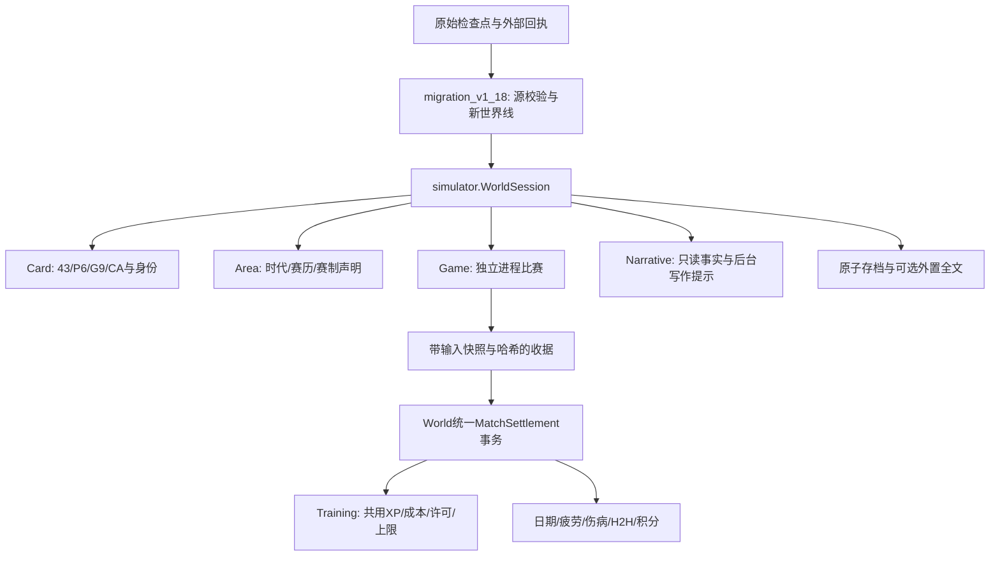

# V1.18模块边界

`WorldExtensions._settle_inplace`是唯一现代比赛入账管。直接收据走`settle_match`，自带模拟的练习/赛事/小组也调用同一管。训练不直接读取文学叙述加点；观赛和奖励必须有已知来源或已登记凭证。

CA由冻结的`card_training_v112.compute_card`及身体支持后的表现值汇总，不在逐分模型中直接指定赢家。比赛学习的挑战估计可以参考对手CA；这与把CA直接变成单分胜率是不同用途。

`Game/formats_v1_18`统一11分、净胜2分、先赢局数和服务次序；`competition_v1_18`处理小表和签位证据。两种比赛引擎共享技术与战术依赖，summary仍是聚合近似，不能伪装成逐板全文。

数值训练核心沿用冻结V1.1.7；`Training/v1_18`添加来源去重、比赛XP、奖励预算与银行守恒检查。旧模块标识保留用于追溯，所有新生涯调用公开`simulator`入口。
